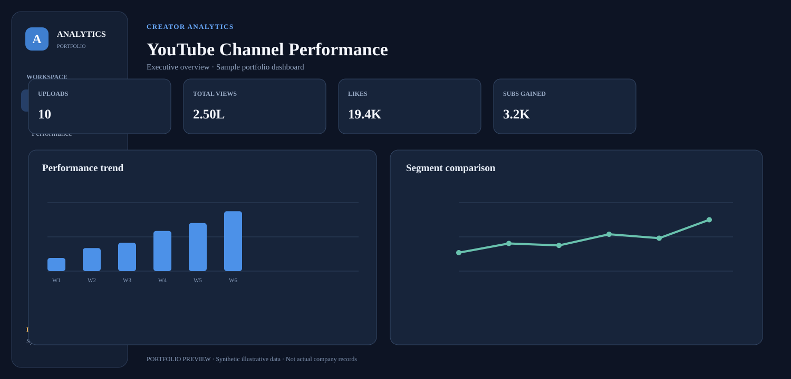

> Preview illustration built from synthetic sample data; it is not a screenshot of a live Power BI report.

# YouTube Channel Performance Analysis

## Project overview
Measure views, engagement, subscriber conversion, upload cadence, and content format performance.

**Domain:** Creator and channel analytics  
**Tools:** PostgreSQL, SQL  
**Database:** PostgreSQL

## Business questions
- What are the main performance indicators?
- How do results vary across time, categories, locations, or customer groups?
- Which segments contribute most or need attention?
- What patterns should be investigated further?

## Repository structure
- `analysis.sql` — table creation, clearly labelled synthetic sample data, and 8 analysis queries.

## How to run
1. Open PostgreSQL using pgAdmin or psql.
2. Create or select a practice database.
3. Open `analysis.sql`.
4. Execute the script from top to bottom.
5. Review each result set and adapt the queries to a larger dataset.

## SQL concepts demonstrated
Aggregations, conditional counts, CASE expressions, date functions, CTEs, window functions, ranking, and percentage calculations.

## Data note
This repository currently uses **synthetic illustrative sample records** created for portfolio practice. The figures are not actual company, customer, financial, market, platform, or operational records. Do not present the sample results as real-world findings.

## Suggested portfolio extension
Replace the sample rows with a documented, appropriately licensed dataset; validate data quality; add more dimensions; and publish a dashboard with metric definitions and source notes.

## Author
Omkar S. Kshirsagar
